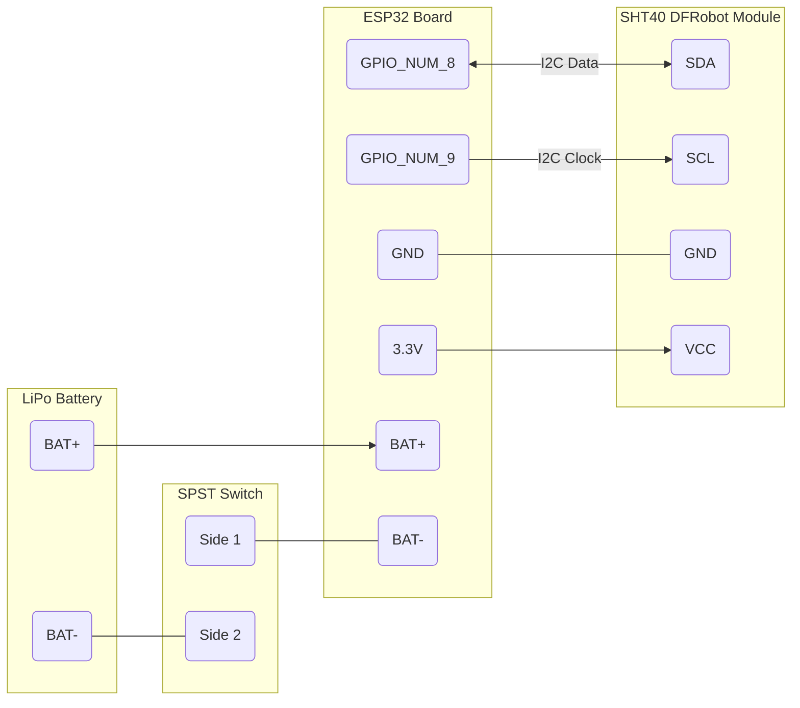

# VeloCliMap ESP32

Firmware for the **VeloCliMap** sensor, a low-cost, reproducible air temperature and relative humidity station designed to take measurements **on the move, from a bicycle**.

The firmware runs on an ESP32-C3, reads an SHT40 sensor over I2C and exposes the values over Bluetooth Low Energy. Measurements are collected by the Android app [VeloClimApp](https://github.com/orbisgis/veloclimapp), which attaches the smartphone's GPS position to each record.


# Context

VeloCliMap was built for **VéloClimat**, a participatory research project studying how climate change, and heat waves in particular, affects cycling, and how the geography of an area (including human development) shapes the local microclimate. The sensor is used in citizen data-collection workshops (*ThermoParty*) as well as scientific measurement campaigns.

VéloClimat was initiated by the GEODATICS team of the Lab-STICC, with support from the GEOMANUM Foundation. It brings together researchers from HEPIA (Geneva), HEIG-VD (Vaud), sports-medicine doctors from the CHUV (Lausanne) and the SHAKER team of the Lab-STICC. The companion app is being developed further within the ANR project [UMOVE-CC](https://anr.fr/Project-ANR-25-CE22-3992).


# How it works

```
SHT40 ──I2C──▶ ESP32-C3 (this firmware) ──BLE──▶ VeloClimApp (Android) ──▶ CSV + GPS ──▶ server / QGIS / Python
```

1. **Measurement.** At startup the ESP32 configures the I2C bus (GPIO 8 = SDA, GPIO 9 = SCL, 400 kHz) and the SHT40 (address `0x44`). Each time a client reads the BLE characteristic, a new measurement is triggered (`sht_get_data` in `main/gatts_server.c`), the CRC is checked and the raw values are converted to °C and % RH (humidity is clamped to 0–100 %).
2. **BLE broadcast.** The ESP32 advertises itself as `VC_SENS_XXXXXX` (from the last 3 bytes of its MAC address), waits for a connection, and answers read requests. Advertising restarts automatically after a disconnection.
3. **Power.** The program is fully event-driven: once `app_main()` returns, FreeRTOS idles until a BLE event occurs, which keeps consumption low.

## BLE interface

| Item | Value |
|---|---|
| Advertised name | `VC_SENS_XXXXXX` |
| Service UUID | `0x181A` (Environmental Sensing) |
| Characteristic UUID | `0xFF01`, read only |
| Value | 8 bytes: two little-endian IEEE-754 `float`, temperature (°C) then relative humidity (%) |

## Measurement precision

The SHT40 offers three repeatability levels, selected in `sht_get_data` by the line
`uint8_t command[1] = {SHT40_MEDIUM_ACCURACY_MEASURMENT_COMMAND};`:

| Level | Command | Repeatability | Measurement time |
|---|---|---|---|
| Low | `0xE0` | ~0.1 °C | 1.3–1.7 ms |
| Medium (default) | `0xF6` | ~0.07 °C | 3.7–4.5 ms |
| High | `0xFD` | ~0.04 °C | 6.9–8.2 ms |


# Hardware

## Electronic components

| Component | Role | Reference | Approx. price (€) | Supplier |
|---|---|---|---|---|
| Microcontroller | Data acquisition and BLE transmission | Olimex ESP32-C3-DevKit-Lipo | 5–6 | [Mouser](https://www.mouser.fr/ProductDetail/Olimex-Ltd/ESP32-C3-DevKit-Lipo) |
| Temperature / humidity sensor | Measurement | DFRobot SHT40 (SEN0428) | 6–7 | [Mouser](https://www.mouser.fr/ProductDetail/DFRobot/SEN0428) |
| Programmer | Flashing the firmware | Olimex ESP-PROG-C | 10–15 | [Mouser](https://www.mouser.fr/ProductDetail/Olimex-Ltd/ESP-PROG-C) |
| Slide switch (SPST) | On / off | RS 7347312 | 5–6 | [RS Online](https://fr.rs-online.com/web/p/interrupteurs-a-glissiere/7347312) |
| LiPo battery 3.7 V | Power supply | RS 1449405 | 15–18 | [RS Online](https://fr.rs-online.com/web/p/piles-rechargeables-taille-speciale/1449405) |

You will also need electrical wire, heat-shrink tubing and strong double-sided tape (nano tape) to hold the battery.

## Tested hardware

- ESP32-C3 (Olimex devkit-lipo)
- ESP32-WROOM-32E
- SHT40 (DFRobot module v1)

## Pinout

| ESP32 | Connected to |
|---|---|
| GPIO 8 | SHT40 SDA |
| GPIO 9 | SHT40 SCL |
| GND | SHT40 GND |
| 3.3V | SHT40 VCC |
| BAT- | Switch side 1 (switch side 2 → battery −) |
| BAT+ | Battery + |

The battery's negative wire goes through the switch, so the whole device is switched off at once.



## Enclosure and radiation shield

The sensor sits on a 3-blade disc (Ø 42.5 mm) inside a **white PVC tube** (50 mm outer diameter, 200 mm long, 42.5–43 mm free inner diameter) pointing in the direction of travel. The tube shields the sensor from the sun and is ventilated by the cyclist's speed; wrap it with two turns of white tape to reflect solar and thermal radiation. The electronics box is taped on top of the tube, which is fastened to the handlebar with brackets and reusable cable ties.

3D-printed parts: sensor holder disc, electronics box and its cover, upper and lower handlebar brackets. Print settings: white PETG, 20 % infill, 0.4 mm nozzle, 0.2 mm layer height (0.26 mm possible). The `case/` folder contains STL files for the electronics box.

### Assembly tips

- Before soldering, pass the four 25 cm SHT40 wires and the battery wires through the holes in the box, to avoid having to desolder them later.
- Fix the ESP32 with four M3 × 10 mm bolts; fix the sensor on its disc with two M2 × 10 mm screws.
- The switch hole can be softened with a heat gun or hot-air station before inserting the switch.
- Tape the battery vertically with nano tape.
- The battery connector on the ESP32 can be desoldered so the wires can be soldered through the vias.
- Protect the soldered wires with heat-shrink tubing.
- Label each sensor with its BLE identifier.


# Build and flash

## Dependencies

- [ESP-IDF](https://docs.espressif.com/projects/esp-idf/en/v5.4.1/esp32c3/get-started/index.html) v5.4.1

## Build

```bash
git clone https://github.com/orbisgis/veloclimap_esp32_firmware.git
cd veloclimap_esp32_firmware
get_idf                      # or load the ESP-IDF environment in your terminal
idf.py set-target esp32c3    # match your ESP32 model
idf.py build
```

## Flash

Connect the ESP32 to your computer over USB, then:

```bash
idf.py flash monitor
```

Each push and pull request is also built by GitHub Actions; the firmware binaries are available as workflow artifacts.

## Check before assembling

- the right ESP32 target is selected (`idf.py set-target`),
- the flash size matches your board (`idf.py menuconfig`),
- the I2C pins match your wiring (`GPIO_SDA_PIN` and `GPIO_SCL_PIN` in `main/gatts_server.c`),
- the sensor shows up as `VC_SENS_XXXXXX` in VeloClimApp (or any BLE scanner) and returns plausible values.


# Using the sensor

1. Install [VeloClimApp](https://github.com/orbisgis/veloclimapp/releases) on an Android phone, grant all requested permissions, and turn on Bluetooth and GPS.
2. Mount the sensor on the handlebar (foam or an old inner tube limits vibrations) and switch it on.
3. **Ride for about 30 seconds before starting the acquisition**, so the sensor adapts to outdoor conditions.
4. In the app, select the sensor by its identifier and start the acquisition. Stop it at the end of the ride **before** switching the sensor off, otherwise the measurements are lost.
5. Export the session as CSV or synchronise it with a server.

> **Warning.** When stopped or riding slowly, the measured air temperature may be wrong: biased upwards by radiation and lack of ventilation, or lagging behind (in time and therefore in space) because the poorly ventilated sensor reacts slowly. Tests are ongoing to determine the minimum speed for usable measurements.

To charge the battery, plug the board into USB-C with the switch in the **On** position. The app does not display the sensor's battery level.

## Data format

VeloClimApp records one CSV file per session:

```csv
Timestamp,Temperature,Humidity,Latitude,Longitude,Accuracy
2026-05-18T10:23:01.000Z,22.45,58.30,47.823456,-3.12345,4.50
2026-05-18T10:23:02.000Z,22.49,58.29,47.823451,-3.12346,4.50
```

Temperature in °C, humidity in % RH, latitude/longitude in degrees, GPS accuracy in metres. These files can be loaded directly in QGIS (*Add delimited text layer*) or with pandas for analysis.


# Credits

VeloCliMap sensor: Erwan Bocher (CNRS/Lab-STICC), Jérémy Bernard (CNRS/EDYTEM/Lab-STICC),
Dominique Heller (UBS/Lab-STICC), Camille Colimard (UBS/Lab-STICC)

This firmware was originally written by TheLastResort in
[The-Last-Resort-FR/VeloClimat_ESP32_Firmware](https://github.com/The-Last-Resort-FR/VeloClimat_ESP32_Firmware),
released into the public domain (Unlicense). Its full history has been imported into this repository.

# License

GPL-3.0, see [LICENSE](LICENSE).
